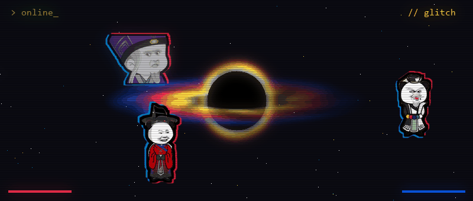

<h1 align="center">
  
</h1>

<div align="center">
  
</div>

<div align="center">
  
</div>

<div align="center">
  
</div>

---

## 👾 About Me

```yaml
name: KK
status: student 🎓
location: UTC+7
learning: [Machine Learning, Game Theory, Java DSA, Recommender Systems]
currently: building solvers & predictors
mode: online_
```

- 🎓 I'm a student who learns best by building things and breaking them
- 🃏 Right now I'm exploring **game theory** through card games like Liêng and poker
- ⚽ I'm practicing honest ML evaluation by predicting **Premier League** matches
- 🧠 Next up: recommender systems, PyTorch, and getting better at algorithms in Java

---

## 🧪 Projects I'm Learning With

<div align="center">
<table>
  <tr>
    <td>
      <a href="https://github.com/kkdoestech/lieng-stealer">
        
      </a>
    </td>
    <td>
      <a href="https://github.com/kkdoestech/matchoracle-honest">
        
      </a>
    </td>
  </tr>
  <tr>
    <td>
      <a href="https://github.com/kkdoestech/m6rec-pytorch">
        
      </a>
    </td>
    <td>
      <a href="https://github.com/kkdoestech/stealer-recreation">
        
      </a>
    </td>
  </tr>
</table>
</div>

---

## 🛠️ Tech Stack

<div align="center">
  
  <br/><br/>
  
  
  
  
  
  
  
</div>

---

## 📊 GitHub Stats

<div align="center">
  
  
  <br/>
  
</div>

<h1 align="center">
  
</h1>
